<div align="center">

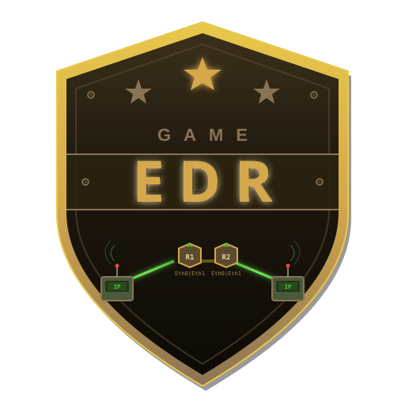

# GAME EDR

**Simulateur d'exploitation des demandes de raccordement**

Un jeu web éducatif en 3D pour apprendre le **routage IP**, le **calcul d'adresses**, le **découpage en sous-réseaux** et le **VLSM**, dans un univers militaire tactique.


[](LICENSE)

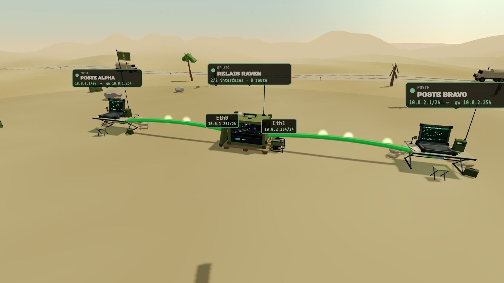

</div>

---

## Sommaire

- [Présentation](#présentation)
- [Captures d'écran](#captures-décran)
- [Modes de jeu](#modes-de-jeu)
- [Les 10 missions](#les-10-missions)
- [Commandes](#commandes)
- [Démarrage rapide](#démarrage-rapide)
- [Déploiement en production](#déploiement-en-production)
- [Structure du projet](#structure-du-projet)
- [Documentation](#documentation)
- [Crédits](#crédits)
- [Licence](#licence)

---

## Présentation

Sergent, votre mission : rétablir la communication entre le **Poste ALPHA** et le **Poste BRAVO**.

Chaque mission place sur le terrain des postes de commandement et des relais (routeurs) reliés par des câbles. Le joueur configure lui-même :

- l'**adresse IP**, le **masque** et la **passerelle** de chaque poste ;
- les **interfaces** (Eth0, Eth1, Eth2) et la **table de routage statique** de chaque relais.

Il lance ensuite un **ping** : un paquet animé parcourt réellement le chemin calculé par le moteur de routage, à l'aller puis au retour. S'il se perd, le jeu montre l'équipement en cause et explique pourquoi.

### Points forts

| | |
|---|---|
| 🛰️ **Simulation de routage réelle** | Le ping suit les réseaux directement connectés, puis les routes statiques, saut par saut, avec détection des boucles (TTL). |
| 📦 **Équipements réalistes** | Routeur en caisse de transport (baie 19", switch, onduleur, groupe électrogène) et poste de campagne (PC durci, radio, carte). Les écrans et les voyants affichent la configuration en direct. |
| 🌍 **10 environnements** | Désert, savane, canyon, forêt, jungle, montagne, arctique, zone urbaine de nuit, zone industrielle, bunker. |
| 🚚 **Décor vivant** | Convois sur la route, hélicoptère, oiseaux, météo (sable, pluie, neige, braises), drapeau, radar. Les véhicules sont cliquables. |
| 🎯 **Score et progression** | Combos, pénalités, médailles, mentions, rangs, classements et défis entre joueurs. |
| 🧮 **Trois modes d'entraînement** | Calcul d'adresse réseau, sous-réseaux égaux, VLSM, chacun sur 4 niveaux de difficulté. |

---

## Captures d'écran

### Équipements

| Relais (routeur tactique) | Poste de commandement |
|---|---|
| 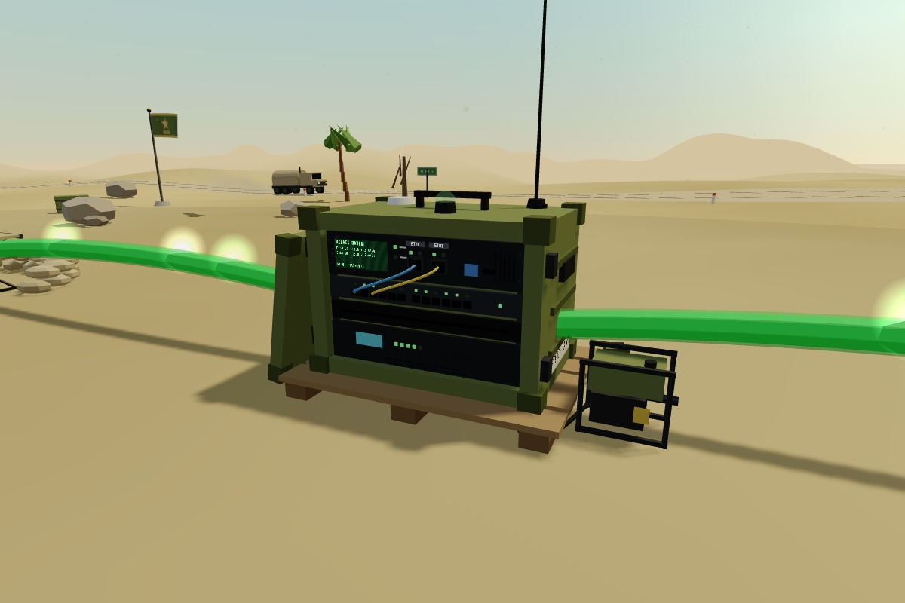 | 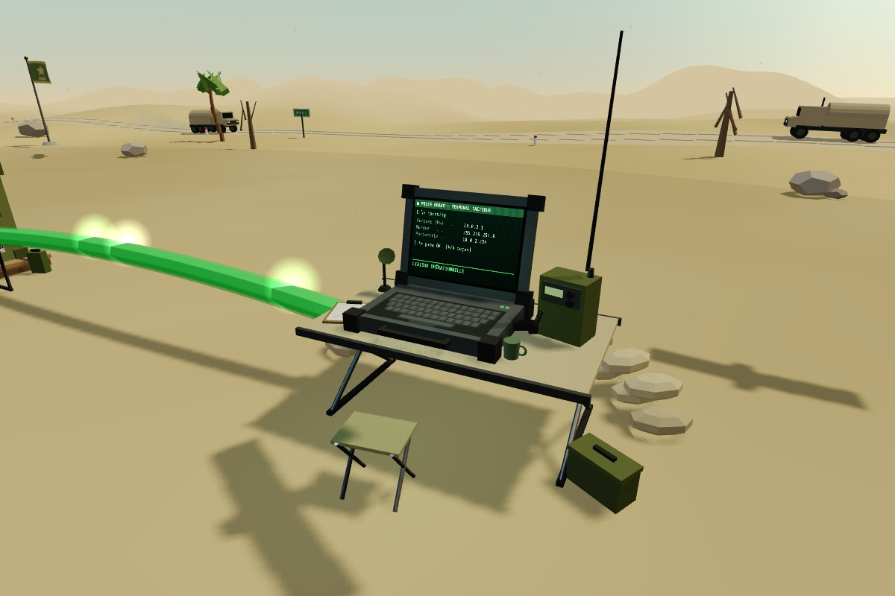 |
| L'écran affiche le nom du relais et l'état de chaque interface. Il y a un voyant de lien par port réel. Le gyrophare passe de l'orange au vert. | L'écran du PC affiche en direct un `ipconfig` de la configuration saisie et l'état de la liaison. |

### Le ping animé

| Paquet en transit | Diagnostic d'erreur |
|---|---|
| 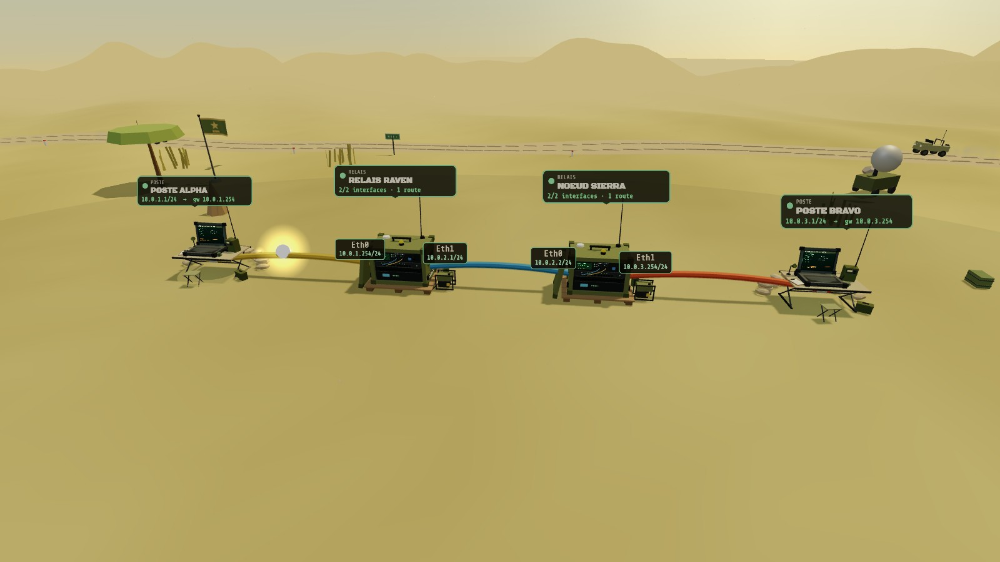 | 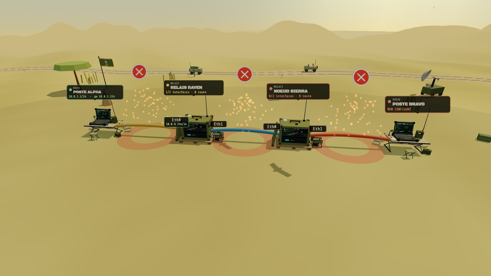 |
| Paquet aller (jaune) puis retour (bleu), saut par saut. | Les câbles dont les deux extrémités ne sont pas dans le même sous-réseau clignotent en rouge. |

### Interface

| Console de configuration d'un relais | Entraînement VLSM |
|---|---|
| 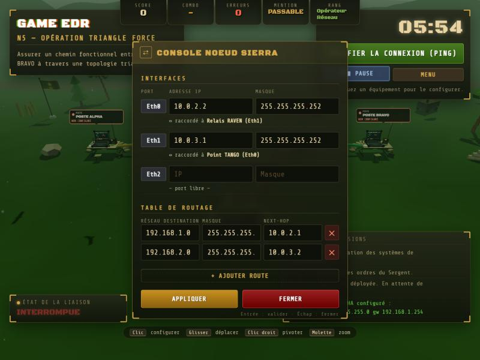 | 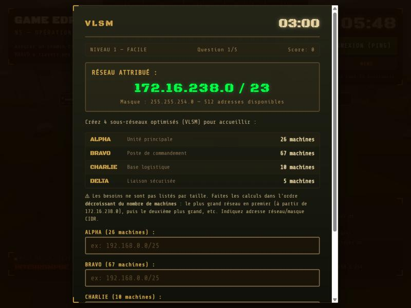 |
| Chaque port indique l'équipement auquel il est raccordé. Les routes s'ajoutent et se suppriment. | Les besoins sont listés dans le désordre : à vous de les traiter du plus grand au plus petit. |

### Environnements

| Arctique | Zone urbaine (nuit) |
|---|---|
| 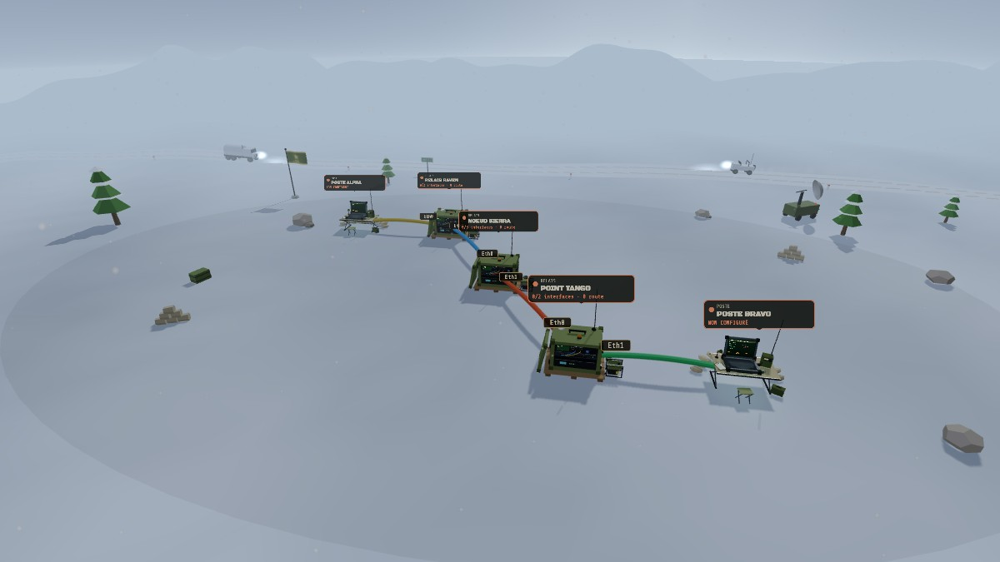 | 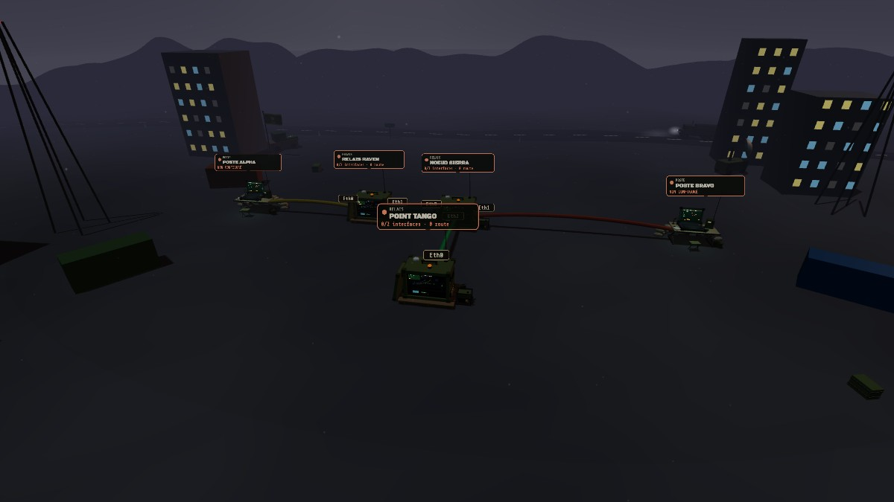 |
| **Canyon** | **Bunker souterrain** |
| 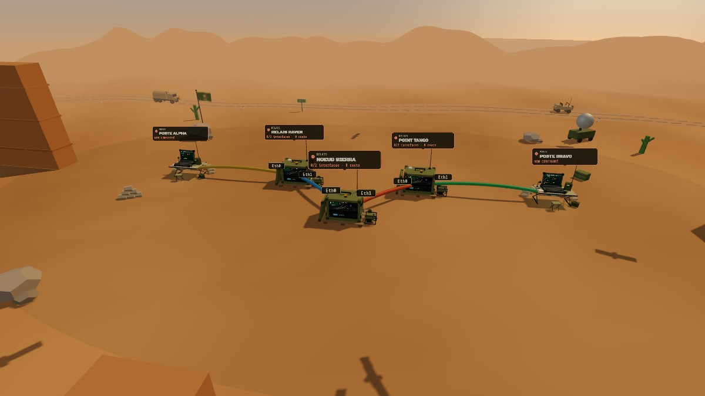 | 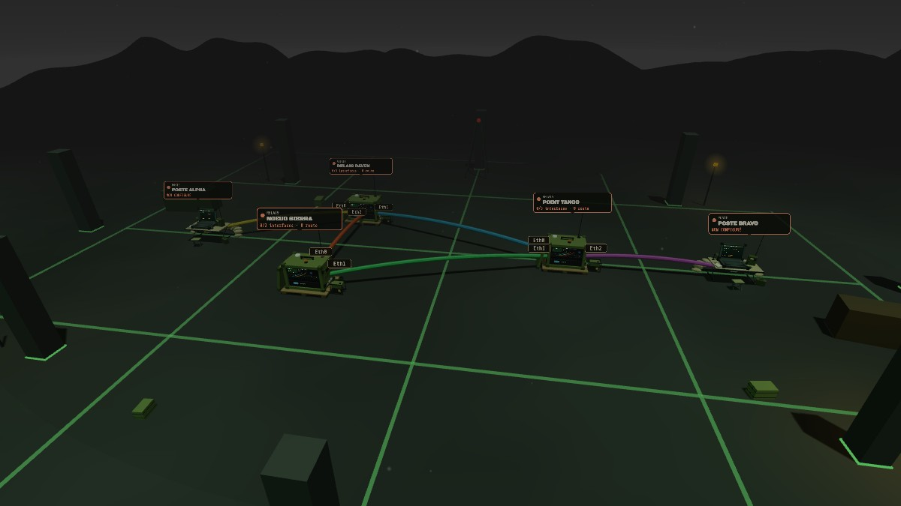 |

---

## Modes de jeu

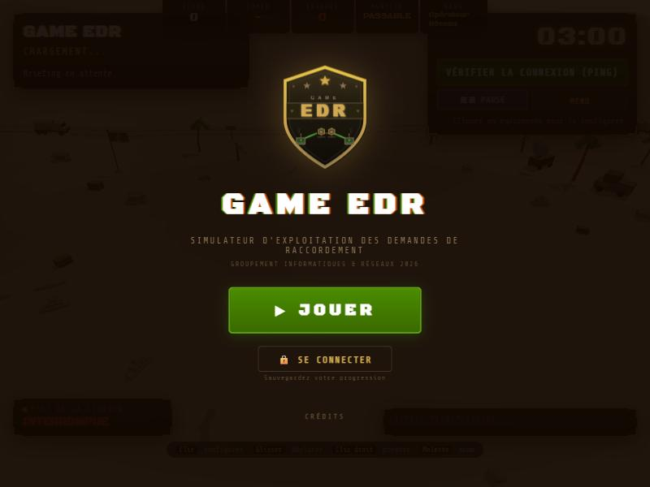

On peut jouer **en anonyme** ou **avec un compte**. Le compte sauvegarde la progression, enregistre les scores dans les classements et donne accès aux défis.

1. **Jeu classique** : les 10 missions de configuration réseau en 3D. Après les missions 1, 2 et 3, une **épreuve bonus** est proposée : adresse réseau, sous-réseaux égaux puis VLSM.
2. **Calcul d'adresse réseau** : à partir d'une IP et d'un masque, trouver l'adresse réseau, le broadcast, la première et la dernière adresse utilisables et le nombre d'hôtes.
3. **Sous-réseaux** : découper un réseau en 2, 4, 8 ou 16 sous-réseaux identiques.
4. **VLSM** : créer 4 à 7 sous-réseaux de tailles différentes, avec le masque optimal pour chacun.

> **Méthode VLSM appliquée par le jeu.** Les besoins sont affichés dans un ordre quelconque. Le calcul doit se faire dans l'ordre **décroissant du nombre de machines** : le plus grand réseau d'abord, à partir de l'adresse du réseau attribué, puis le deuxième plus grand juste après, et ainsi de suite. Une réponse valide mais calculée dans un autre ordre est refusée, et la correction détaillée s'affiche.

Dans les modes d'entraînement, une question rapporte 100 points sans erreur, 60 avec une erreur et 30 avec deux. Le **bonus de vitesse** (jusqu'à 50 points) ne récompense qu'une réponse entièrement juste. Une réponse vide ou entièrement fausse rapporte 0 point.

<br clear="right">

---

## Les 10 missions

| # | Opération | Thème | Environnement |
|:-:|---|---|---|
| 1 | WIRE FALCON | Routage direct via un relais | Désert |
| 2 | DEEP RELAY | Deux relais en série, routes statiques | Savane |
| 3 | CHAIN COMMAND | Chaîne de trois relais | Canyon |
| 4 | NARROW BAND | Subnetting avec masques /26 ou /30 | Forêt |
| 5 | TRIANGLE FORCE | Topologie en triangle | Jungle |
| 6 | CARRÉ TACTIQUE | Quatre relais en carré, deux chemins possibles | Montagne |
| 7 | ÉTOILE | Relais central desservant trois branches | Arctique |
| 8 | RÉSEAU EN T | Trois relais en ligne et une branche latérale | Zone urbaine |
| 9 | LOSANGE | Deux chemins qui se rejoignent sur un quatrième relais | Zone industrielle |
| 10 | DERNIER MAILLON | Examen final : quatre relais maillés | Bunker |

Chaque mission commence par un **briefing** (situation, mission, contraintes, délai) et se termine par un **débriefing** : détail du score, médaille, mention, point fort, point faible et conseil personnalisé.

---

## Commandes

| Action | Commande |
|---|---|
| Configurer un équipement | **Clic** sur le poste ou le relais |
| Déplacer un équipement | **Glisser** avec le clic gauche |
| Déplacer la vue | **Glisser** dans le vide |
| Pivoter la caméra | **Clic droit** + glisser |
| Zoomer | **Molette**, `+` / `-` |
| Centrer sur un équipement | **Double-clic** |
| Revenir à la vue initiale | `R` |
| Valider / fermer une fenêtre | `Entrée` / `Échap` |
| Pause | `Échap` (hors fenêtre) ou bouton **PAUSE** |
| Contacter un véhicule, l'hélicoptère, le radar | **Clic** sur l'élément |

---

## Démarrage rapide

**Prérequis :** PHP 8 (pour les comptes, les scores et les défis) et un navigateur récent avec WebGL.

```bash
git clone https://github.com/Vomerox/game-edr.git
cd game-edr
php -S localhost:8000
```

Ouvrez ensuite <http://localhost:8000>.

> Sans PHP, n'importe quel serveur de fichiers statiques suffit pour jouer en anonyme (`python -m http.server`). Les classements basculent alors sur le stockage local du navigateur, et la création de comptes n'est pas disponible.

Les fichiers de données (`accounts/users.json`, `score/level_*.json`, `challenges/challenges.json`) ne sont pas versionnés. Les API PHP les créent au premier enregistrement.

---

## Déploiement en production

Le jeu tourne sur un serveur **Apache + PHP** classique, à la racine du site. Le guide pas à pas pour Debian (paquets, droits d'écriture, `.htaccess`, cache, sécurité) est dans **[docs/INSTALLATION.md](docs/INSTALLATION.md)**.

---

## Structure du projet

```
game-edr/
├── index.html              Page unique : HUD, fenêtres de configuration, écrans de jeu
├── css/
│   ├── styles.css          Thème principal (militaire désert)
│   ├── enhancements.css    Panneaux, fenêtres de configuration, aide aux commandes
│   └── css2.css            Polices Black Ops One et Share Tech Mono (servies par Google Fonts)
├── js/
│   ├── game.js             Moteur : scène, biomes, interactions, routage, ping
│   ├── equipment.js        Modèles 3D des relais et des postes, écrans et voyants
│   ├── ambient.js          Ciel, relief, route, véhicules, hélicoptère, météo
│   ├── gameplay.js         Caméra, plaques d'identification, animation des paquets
│   ├── levels.js           Topologies des 10 missions
│   ├── missions.js         Briefings, alias, débriefings
│   ├── scoring.js          Score, combos, médailles, rangs, journal
│   ├── bonus.js            Épreuves bonus (adresse, sous-réseaux, VLSM)
│   ├── training-*.js       Modes d'entraînement
│   ├── accounts.js         Comptes joueurs (client)
│   ├── highscores.js       Classements façon borne d'arcade
│   └── ip-utils.js         Outils de calcul IPv4
├── accounts/api.php        API des comptes (mots de passe hachés en bcrypt)
├── score/api.php           API des classements
├── challenges/api.php      API des défis entre joueurs
├── assets/                 Logo, illustrations, vidéo de briefing
├── lib/three.min.js        Three.js r128 (inclus localement)
└── docs/                   Documentation et captures d'écran
```

---

## Documentation

| Document | Contenu |
|---|---|
| [docs/INSTALLATION.md](docs/INSTALLATION.md) | Installation sur un serveur Debian avec Apache et PHP |
| [docs/ARCHITECTURE.md](docs/ARCHITECTURE.md) | Fonctionnement interne : modules, moteur de routage, rendu 3D, score, API |
| [docs/PROMPT_RECREATION.md](docs/PROMPT_RECREATION.md) | Cahier des charges détaillé de la version d'origine du jeu |

---

## Crédits

Créé par le **cours réseaux du Groupement Informatiques & Réseaux, 2026**.

- Rendu 3D : [Three.js](https://threejs.org/) (licence MIT)
- Polices : *Black Ops One* et *Share Tech Mono* (Google Fonts, licence SIL OFL)

---

## Licence

Ce projet est distribué sous **licence MIT** : vous pouvez l'utiliser, le modifier et le redistribuer librement, y compris pour vos propres cours, à condition de conserver la mention de copyright et le texte de la licence. Voir le fichier [LICENSE](LICENSE).

La bibliothèque Three.js incluse dans `lib/` conserve sa propre licence MIT.
