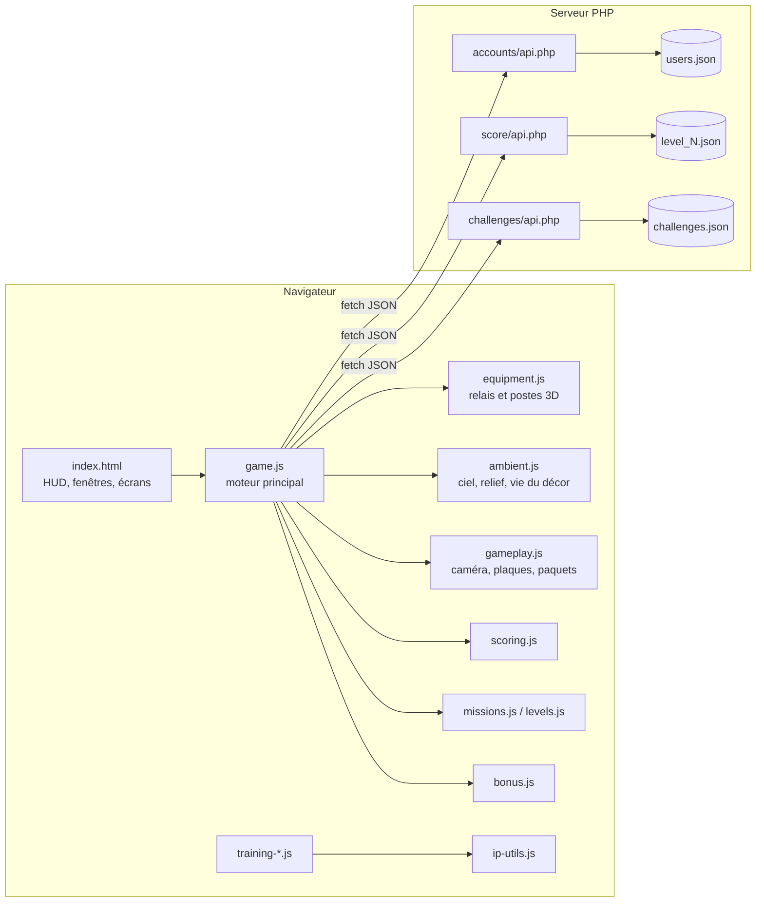

# Architecture de GAME EDR

GAME EDR est une application web **sans framework et sans étape de compilation** : une page HTML, des scripts JavaScript classiques chargés dans un ordre précis, Three.js pour la 3D et trois API PHP pour la persistance.

---

## Ordre de chargement des scripts

Les modules communiquent par des variables globales. L'ordre de chargement de `index.html` est donc important :

1. `lib/three.min.js` (Three.js r128)
2. Données et logique pure : `levels.js`, `missions.js`, `scoring.js`, `highscores.js`, `ip-utils.js`, `bonus.js`, `training-network.js`, `training-subnet.js`, `training-vlsm.js`, `accounts.js`
3. Rendu : `equipment.js`, `ambient.js`, `gameplay.js`. Ils sont chargés **avant** `game.js`, mais n'utilisent les globales de `game.js` (`scene`, `camera`, `nodes3D`, `levelData`, `linkLines`) qu'au moment où leurs fonctions sont appelées.
4. `game.js` : crée la scène, lance la boucle d'animation et branche tous les événements.

---

## Modules

| Fichier | Rôle |
|---|---|
| `game.js` | Scène Three.js, éclairage, terrain, 10 biomes et leurs décors, chargement des niveaux, câbles, interactions souris, fenêtres de configuration, validation stricte des saisies, moteur de routage, ping, minuteur, pause, menus, comptes, défis. |
| `equipment.js` | Construit les modèles 3D. Le **relais** est une caisse de transport sur palette avec une baie 19" (routeur, switch, panneau passe-câbles, onduleur), un groupe électrogène et un gyrophare. Le **poste** est une table de campagne avec un PC durci, une radio, une carte, un tabouret et des sacs de sable. Les écrans sont des `CanvasTexture` redessinées selon la configuration. Chaque interface réelle du niveau a son port et ses voyants. |
| `ambient.js` | Dôme de ciel en dégradé, fonction de relief `terrainHeight()` (zone de jeu plane, dunes à l'horizon), route, convois (camions, jeeps, blindés, voitures), hélicoptère, oiseaux, météo par particules, drapeau animé, radar, gyrophares. Gère aussi les clics sur ces éléments. |
| `gameplay.js` | `CameraRig` (zoom, rotation, déplacement, cadrage automatique selon l'emprise du niveau) et `Gameplay` (plaques d'identification, anneaux de survol et de sélection, animation des paquets, gerbes de particules, câbles en défaut, flux de données après succès). |
| `levels.js` | Topologie des 10 missions : nœuds (`pc` / `router`), positions, interfaces et liens (`n1`/`int1` ↔ `n2`/`int2`). |
| `missions.js` | Noms d'opération, alias des équipements (RAVEN, SIERRA, TANGO…), briefings, seuils de médailles, HTML du débriefing. |
| `scoring.js` | État de mission, combos, pénalités, calcul final, mentions, médailles, rangs, profil local, journal des transmissions. |
| `bonus.js` | Épreuves bonus des missions 1 à 3 : adresse réseau, sous-réseaux égaux, VLSM. |
| `training-*.js` | Trois modes d'entraînement de 4 niveaux et 5 questions chacun. |
| `highscores.js` | Classements façon borne d'arcade. Repli sur `localStorage` si l'API est indisponible. |
| `accounts.js` | Connexion, progression, indicateur de compte. |
| `ip-utils.js` | Conversions IP ↔ nombre, masque ↔ CIDR, adresse réseau, broadcast, nombre d'hôtes. |

---

## Moteur de routage et ping

La vérification de la liaison se fait en deux étapes.

**1. Contrôle physique.** Pour chaque câble, les deux extrémités doivent avoir une IP et un masque, le même masque, et être dans le même sous-réseau. Les câbles en défaut clignotent en rouge et sont listés dans le journal.

**2. Routage.** `routePacket(nœud, ipCible, ttl, trace)` est récursif et enregistre dans `trace` chaque nœud traversé :

- **Poste** : si la cible est dans son sous-réseau, il l'atteint directement. Sinon il transmet à sa **passerelle**, qui doit être l'adresse d'un équipement existant.
- **Relais** : il cherche d'abord un **réseau directement connecté** à l'une de ses interfaces, puis une **route statique** dont le réseau contient la cible. Il transmet alors au **next-hop**.
- Le **TTL** (10 sauts) détecte les boucles de routage.

Le ping est testé dans les deux sens : ALPHA → BRAVO, puis BRAVO → ALPHA. La trace est rejouée par `Gameplay.animatePacket()` en suivant les courbes réelles des câbles. Le chronomètre est suspendu pendant l'animation. Un échec affiche une croix sur le dernier équipement atteint et la raison dans le journal.

---

## Rendu 3D

- Three.js r128, `WebGLRenderer` avec anticrénelage, ombres PCF douces (2048²) et tone mapping ACES Filmic.
- Éclairage : lumière ambiante, lumière hémisphérique (ciel / sol), soleil directionnel avec ombres, lumière de remplissage. Toutes sont reparamétrées par biome dans `applyBiome()`.
- Terrain de 640 × 640 unités avec des variations de teinte par sommet. Le relief vient de `terrainHeight()`, partagé par le terrain, la route, les véhicules et le décor.
- Les plaques d'identification et les étiquettes d'interface sont des `Sprite` dessinés sur canvas, toujours visibles (`depthTest: false`).
- Les matériaux des équipements sont mis en cache et partagés entre les instances.

---

## Score

| Élément | Valeur |
|---|---|
| Mission réussie | 1000 points de base |
| Bonus de vitesse | `temps restant × 15 × (1 + temps restant / temps total)` |
| Bonus de précision | 500 (0 erreur), 300 (≤ 2), 100 (≤ 5) |
| Bonus tactique | 200 (sans indice) + 150 (≤ 1 ping) + 100 (0 erreur) |
| Combo | combo maximal × 50 |
| Premier essai | 300 |
| Pénalités | ping échoué −80, configuration invalide −40, champ invalide −20 |

Médailles : bronze, argent, or, distinction. Mentions : de PASSABLE à EXCELLENCE. Rangs : d'*Opérateur Réseau* à *Expert Interconnexion*, selon le score cumulé et le nombre de missions réussies.

---

## API PHP

Toutes les API répondent en JSON. L'action est passée dans l'URL (`?action=…`) et les données dans le corps de la requête en JSON.

| API | Actions | Fichier de données |
|---|---|---|
| `accounts/api.php` | `login` (crée le compte à la première connexion), `save_progress`, `load_progress` | `accounts/users.json` (mots de passe en bcrypt) |
| `score/api.php` | `get` (`&level=N`), `save`, `ping` | `score/level_N.json` (20 meilleurs scores par niveau) |
| `challenges/api.php` | `create`, `list`, `accept`, `complete`, `my_challenges`, `ping` | `challenges/challenges.json` |

Les fichiers de données sont créés automatiquement au premier enregistrement. Ils ne sont pas versionnés (voir `.gitignore`).
